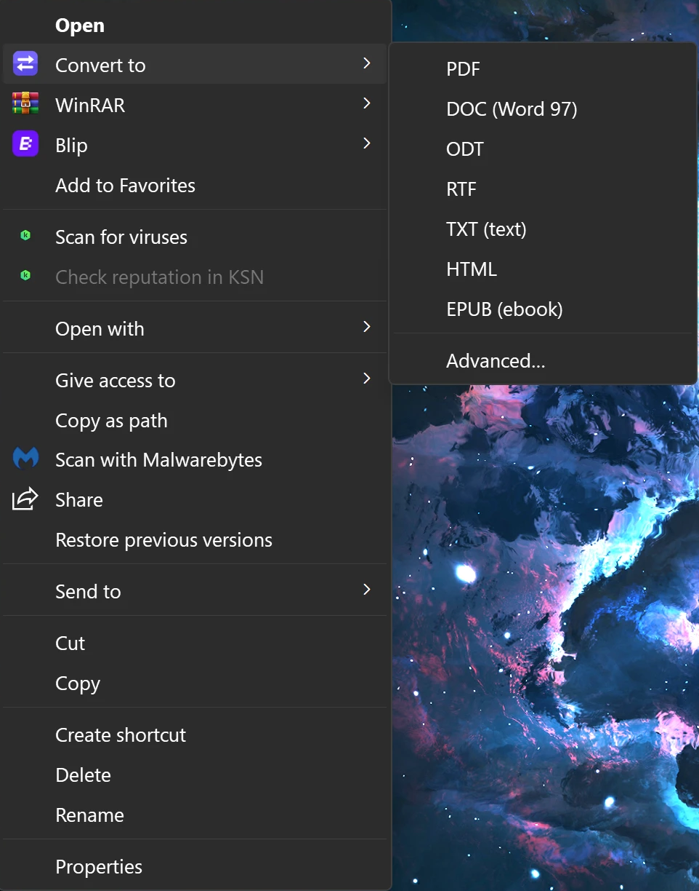

# Simple Converter

Convert files straight from the Windows right-click menu.
Right-click a file → **Convert to ▸**, and you only see the conversions that make sense for that file:
a PDF offers Word, text, images, merge and compress; an MP4 offers other video formats, GIF and audio; a JPG offers PNG, WEBP, ICO and so on.



- **One click**: the result is saved next to the original (`CV.docx` → `CV.pdf`; an existing file is never overwritten, you get `CV (1).pdf`).
- **Many files at once**: select 50 photos, right-click, pick PNG, and they're all converted in one job.
- **Advanced…** opens a small window with format, quality, resize, rotate, trim, resolution, bitrate, PDF page range, DPI and output folder.
- **Notifications** tell you when it's done (click to open the folder) or why it failed.
- **Free and offline**: everything runs locally with open-source engines.

## What it converts

| File type | Converts to | Extra tools |
|---|---|---|
| **Images** (jpg, png, webp, heic, avif, bmp, tiff, gif, ico) | each other, ICO, PDF; GIF → MP4/WEBM | Compress, resize 50 %, rotate, remove EXIF/GPS, combine into one PDF |
| **SVG** | PNG, JPG, WEBP, ICO, PDF | |
| **Video** (mp4, mkv, mov, avi, webm, wmv, flv, m4v, 3gp, mpg) | each other, animated GIF, MP3, M4A, WAV, FLAC, OGG | Compress to 720p, remove audio, save a frame |
| **Audio** (mp3, wav, flac, ogg, m4a, aac, wma, opus, aiff, amr) | each other | Compress, normalize volume |
| **Subtitles** (srt, vtt, ass) | each other | |
| **PDF** | DOCX, TXT, PNG/JPG (per page), EPUB | Merge selected, split, compress, extract images |
| **Word** (doc, docx, odt, rtf) | PDF, DOCX, DOC, ODT, RTF, TXT, HTML, EPUB | |
| **Excel** (xls, xlsx, ods) | PDF, XLSX, XLS, ODS, CSV, JSON, HTML | |
| **CSV / JSON** | XLSX, JSON / CSV, ODS, PDF | |
| **PowerPoint** (ppt, pptx, odp) | PDF, PPTX, PPT, ODP | Slides → PNG images |
| **TXT / Markdown / HTML** | PDF, DOCX, ODT, HTML, MD | |
| **Ebooks** (epub, mobi, azw3, fb2) | EPUB, PDF, MOBI, AZW3, DOCX, TXT | |
| **Archives** (zip, 7z, tar, tgz, rar) | ZIP, 7Z, TAR.GZ | |

## Requirements

- Windows 10 or 11
- [Python 3.10+](https://www.python.org/downloads/)
- [FFmpeg](https://ffmpeg.org/) for video and audio. `install.bat` installs it with winget if it's missing.
- Optional:
  - [LibreOffice](https://www.libreoffice.org/) for Word, Excel and PowerPoint files
  - [Calibre](https://calibre-ebook.com/) for ebooks
  - [WinRAR](https://www.win-rar.com/) to read `.rar` files

```bash
winget install TheDocumentFoundation.LibreOffice
```

```bash
winget install calibre.calibre
```

Menu items whose engine isn't installed are hidden automatically.

## Install

1. Download or clone this repository to a folder you'll keep (for example `C:\Tools\simple-converter`).
2. Double-click **`install.bat`** and click **Yes** on the admin prompt.

The menu is registered for all users: some Windows 11 builds ignore right-click entries that are registered for only one user.
Run `install.bat` again after installing LibreOffice or Calibre, or after moving the folder.

On Windows 11's compact menu, **Convert to** is under **Show more options**. With the classic menu it shows directly.

## Uninstall

Double-click **`uninstall.bat`**, then delete the folder.

## Notes

- Merged PDFs and combined images follow filename order. Rename files `01 …`, `02 …` to control it.
- PDF → Word works best on text-based PDFs; scanned PDFs have no text to extract.
- Logs: `%LOCALAPPDATA%\SimpleConverter\simple-converter.log`

## How it works

`install.py` writes static shell verbs under `SystemFileAssociations\.<ext>\shell\SimpleConverter` in the registry, each one running `launcher.pyw` with an action such as `--op convert --to pdf`.
When several files are selected, Explorer starts one process per file; they meet in a small queue folder and the first one processes the whole batch.

| Path | Purpose |
|---|---|
| `simple_converter/formats.py` | Which conversions each file type offers |
| `simple_converter/jobs.py` | Sends each conversion to the right engine |
| `simple_converter/engines/` | Images (Pillow), media (FFmpeg), PDF (PyMuPDF, pdf2docx), Office (LibreOffice), data (pandas), ebooks and archives |
| `simple_converter/advanced.py` | The Advanced… dialog |

## License

[MIT](LICENSE) © Haitham Joban
